[Home](../README.md) · [Documentation guide](../README.md#documentation)

<a name="dataset"></a>
# Dataset and Sequence Guide

## Download a Recording

All 30 recordings are available on [Hugging Face](https://huggingface.co/datasets/Hilti-Research/hilti-trimble-slam-challenge-2026/tree/main).

Download a run’s complete `rosbag/` directory, including its `.db3` file and `metadata.yaml`. For a first example, use `floor_1_2025-05-05_run_1`, which is used throughout the OpenVINS guide.

<!-- The [download helpers](../challenge_tools_ros/download_data/) are for Google Drive: `download_drive.py` uses `gdown`, and `download_drive_rclone.py` uses a configured `gdrive` remote. Their setup instructions are included in the scripts; they do not download from Hugging Face. -->

## Folder Layout

The structure of the dataset folder is as follows:

```
data/
└── floor_X/
    └── YYYY-MM-DD/
        └── run_Z/
            └── rosbag/
                ├── rosbag.db3 # ROS 2 bag file
                └── metadata.yaml
```

## Preview and Choose a Sequence

Watch the [sequence videos](https://www.youtube.com/playlist?list=PLIbIX8ez6UWS0N2A-lTmwYnmhMPQs8IYU) for a view of the recordings.

The following table provides a detailed categorization of each sequence in the dataset, highlighting key acquisition conditions that affect SLAM performance. In particular, it indicates how each sequence differs in terms of initialization (in-motion/dynamic or static), illumination (including low-light scenarios), environmental complexity (clutter and occlusions), motion characteristics (including aggressive 6-DoF movements) and the degree of visual texture available in the scene.

Select a sequence name to open its Hugging Face rosbag folder. Select a trajectory preview to view the full 500 × 500 image. Blue shows the trajectory, green marks the start, and red marks the end.

**Legend:** ✅ indicates that the condition is present; - indicates that it is absent.

<!-- Equal widths for the five condition columns; HTML preserves layout in Markdown renderers. -->
<table width="100%">
  <thead>
    <tr>
      <th width="25%" align="left">Sequence</th>
      <th width="10%" align="center">Dynamic<br>init.</th>
      <th width="10%" align="center">Low-light</th>
      <th width="10%" align="center">Clutter</th>
      <th width="10%" align="center">Aggressive<br>motion</th>
      <th width="10%" align="center">Poor<br>texture</th>
      <th width="25%" align="center">Trajectory</th>
    </tr>
  </thead>
  <tbody>
    <tr>
      <td align="left"><a href="https://huggingface.co/datasets/Hilti-Research/hilti-trimble-slam-challenge-2026/tree/main/data/floor_1/2025-05-05/run_1/rosbag">floor_1_2025-05-05_run_1</a></td>
      <td align="center">-</td>
      <td align="center">-</td>
      <td align="center">-</td>
      <td align="center">-</td>
      <td align="center">✅</td>
      <td align="center"><a href="../media/groundtruth_floorplans/floor_1_2025-05-05_run_1.jpg">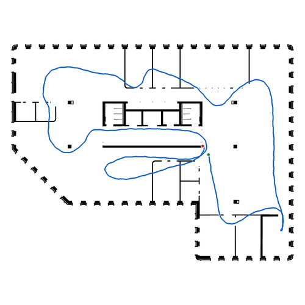</a></td>
    </tr>
    <tr>
      <td align="left"><a href="https://huggingface.co/datasets/Hilti-Research/hilti-trimble-slam-challenge-2026/tree/main/data/floor_1/2025-07-07/run_1/rosbag">floor_1_2025-07-07_run_1</a></td>
      <td align="center">✅</td>
      <td align="center">-</td>
      <td align="center">-</td>
      <td align="center">-</td>
      <td align="center">✅</td>
      <td align="center"><a href="../media/groundtruth_floorplans/floor_1_2025-07-07_run_1.jpg">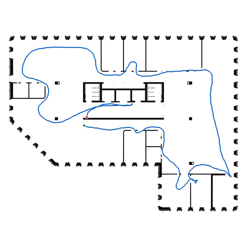</a></td>
    </tr>
    <tr>
      <td align="left"><a href="https://huggingface.co/datasets/Hilti-Research/hilti-trimble-slam-challenge-2026/tree/main/data/floor_1/2025-12-02/run_1/rosbag">floor_1_2025-12-02_run_1</a></td>
      <td align="center">-</td>
      <td align="center">-</td>
      <td align="center">-</td>
      <td align="center">-</td>
      <td align="center">-</td>
      <td align="center"><a href="../media/groundtruth_floorplans/floor_1_2025-12-02_run_1.jpg">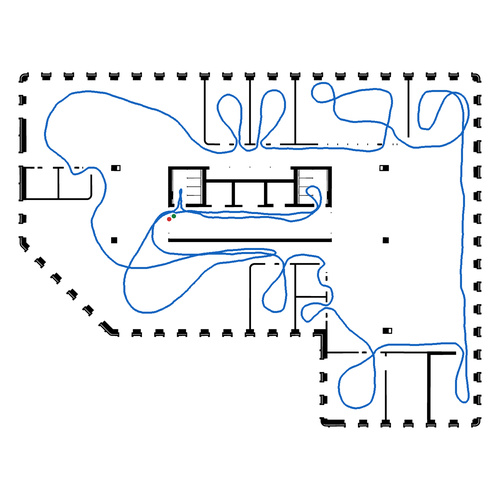</a></td>
    </tr>
    <tr>
      <td align="left"><a href="https://huggingface.co/datasets/Hilti-Research/hilti-trimble-slam-challenge-2026/tree/main/data/floor_2/2025-05-05/run_1/rosbag">floor_2_2025-05-05_run_1</a></td>
      <td align="center">-</td>
      <td align="center">-</td>
      <td align="center">-</td>
      <td align="center">-</td>
      <td align="center">✅</td>
      <td align="center"><a href="../media/groundtruth_floorplans/floor_2_2025-05-05_run_1.jpg">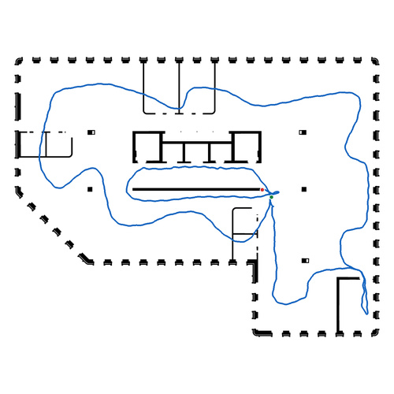</a></td>
    </tr>
    <tr>
      <td align="left"><a href="https://huggingface.co/datasets/Hilti-Research/hilti-trimble-slam-challenge-2026/tree/main/data/floor_2/2025-10-28/run_1/rosbag">floor_2_2025-10-28_run_1</a></td>
      <td align="center">✅</td>
      <td align="center">✅</td>
      <td align="center">✅</td>
      <td align="center">✅</td>
      <td align="center">-</td>
      <td align="center"><a href="../media/groundtruth_floorplans/floor_2_2025-10-28_run_1.jpg">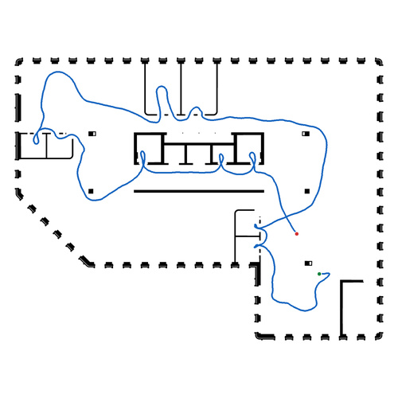</a></td>
    </tr>
    <tr>
      <td align="left"><a href="https://huggingface.co/datasets/Hilti-Research/hilti-trimble-slam-challenge-2026/tree/main/data/floor_2/2025-10-28/run_2/rosbag">floor_2_2025-10-28_run_2</a></td>
      <td align="center">-</td>
      <td align="center">✅</td>
      <td align="center">✅</td>
      <td align="center">✅</td>
      <td align="center">-</td>
      <td align="center"><a href="../media/groundtruth_floorplans/floor_2_2025-10-28_run_2.jpg">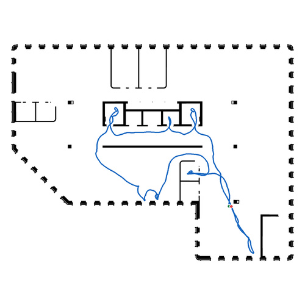</a></td>
    </tr>
    <tr>
      <td align="left"><a href="https://huggingface.co/datasets/Hilti-Research/hilti-trimble-slam-challenge-2026/tree/main/data/floor_2/2025-12-02/run_1/rosbag">floor_2_2025-12-02_run_1</a></td>
      <td align="center">-</td>
      <td align="center">✅</td>
      <td align="center">✅</td>
      <td align="center">✅</td>
      <td align="center">-</td>
      <td align="center"><a href="../media/groundtruth_floorplans/floor_2_2025-12-02_run_1.jpg">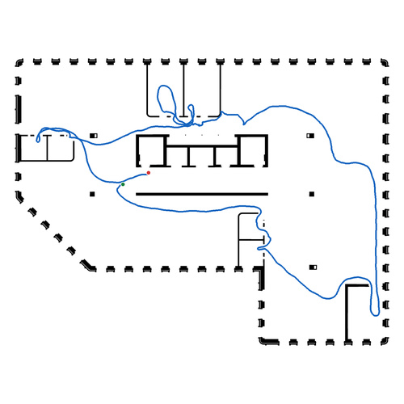</a></td>
    </tr>
    <tr>
      <td align="left"><a href="https://huggingface.co/datasets/Hilti-Research/hilti-trimble-slam-challenge-2026/tree/main/data/floor_2/2025-12-03/run_1/rosbag">floor_2_2025-12-03_run_1</a></td>
      <td align="center">-</td>
      <td align="center">-</td>
      <td align="center">-</td>
      <td align="center">-</td>
      <td align="center">-</td>
      <td align="center"><a href="../media/groundtruth_floorplans/floor_2_2025-12-03_run_1.jpg">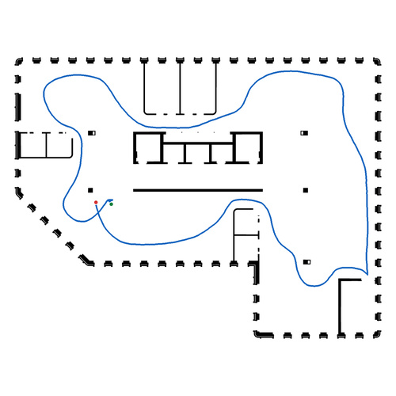</a></td>
    </tr>
    <tr>
      <td align="left"><a href="https://huggingface.co/datasets/Hilti-Research/hilti-trimble-slam-challenge-2026/tree/main/data/floor_3/2025-05-19/run_1/rosbag">floor_3_2025-05-19_run_1</a></td>
      <td align="center">-</td>
      <td align="center">-</td>
      <td align="center">-</td>
      <td align="center">-</td>
      <td align="center">✅</td>
      <td align="center"><a href="../media/groundtruth_floorplans/floor_3_2025-05-19_run_1.jpg">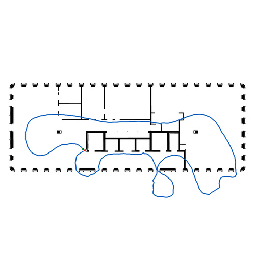</a></td>
    </tr>
    <tr>
      <td align="left"><a href="https://huggingface.co/datasets/Hilti-Research/hilti-trimble-slam-challenge-2026/tree/main/data/floor_3/2025-12-02/run_1/rosbag">floor_3_2025-12-02_run_1</a></td>
      <td align="center">-</td>
      <td align="center">✅</td>
      <td align="center">-</td>
      <td align="center">-</td>
      <td align="center">-</td>
      <td align="center"><a href="../media/groundtruth_floorplans/floor_3_2025-12-02_run_1.jpg">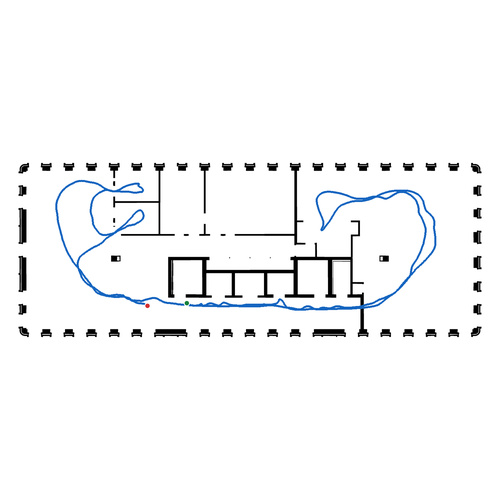</a></td>
    </tr>
    <tr>
      <td align="left"><a href="https://huggingface.co/datasets/Hilti-Research/hilti-trimble-slam-challenge-2026/tree/main/data/floor_4/2025-05-19/run_1/rosbag">floor_4_2025-05-19_run_1</a></td>
      <td align="center">✅</td>
      <td align="center">-</td>
      <td align="center">-</td>
      <td align="center">-</td>
      <td align="center">✅</td>
      <td align="center"><a href="../media/groundtruth_floorplans/floor_4_2025-05-19_run_1.jpg">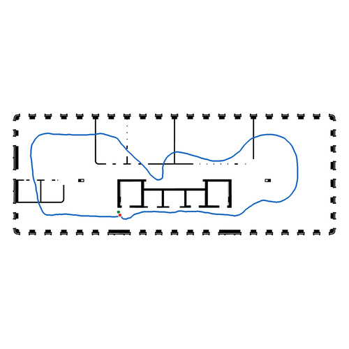</a></td>
    </tr>
    <tr>
      <td align="left"><a href="https://huggingface.co/datasets/Hilti-Research/hilti-trimble-slam-challenge-2026/tree/main/data/floor_4/2025-12-02/run_1/rosbag">floor_4_2025-12-02_run_1</a></td>
      <td align="center">✅</td>
      <td align="center">-</td>
      <td align="center">-</td>
      <td align="center">-</td>
      <td align="center">-</td>
      <td align="center"><a href="../media/groundtruth_floorplans/floor_4_2025-12-02_run_1.jpg">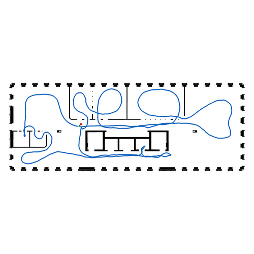</a></td>
    </tr>
    <tr>
      <td align="left"><a href="https://huggingface.co/datasets/Hilti-Research/hilti-trimble-slam-challenge-2026/tree/main/data/floor_5/2025-12-02/run_1/rosbag">floor_5_2025-12-02_run_1</a></td>
      <td align="center">-</td>
      <td align="center">-</td>
      <td align="center">-</td>
      <td align="center">✅</td>
      <td align="center">-</td>
      <td align="center"><a href="../media/groundtruth_floorplans/floor_5_2025-12-02_run_1.jpg">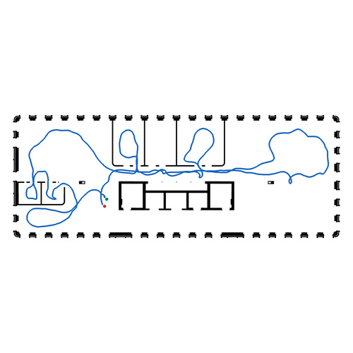</a></td>
    </tr>
    <tr>
      <td align="left"><a href="https://huggingface.co/datasets/Hilti-Research/hilti-trimble-slam-challenge-2026/tree/main/data/floor_6/2025-06-18/run_1/rosbag">floor_6_2025-06-18_run_1</a></td>
      <td align="center">✅</td>
      <td align="center">-</td>
      <td align="center">-</td>
      <td align="center">-</td>
      <td align="center">-</td>
      <td align="center"><a href="../media/groundtruth_floorplans/floor_6_2025-06-18_run_1.jpg">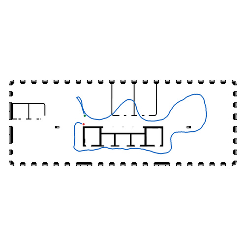</a></td>
    </tr>
    <tr>
      <td align="left"><a href="https://huggingface.co/datasets/Hilti-Research/hilti-trimble-slam-challenge-2026/tree/main/data/floor_6/2025-07-07/run_1/rosbag">floor_6_2025-07-07_run_1</a></td>
      <td align="center">✅</td>
      <td align="center">-</td>
      <td align="center">-</td>
      <td align="center">-</td>
      <td align="center">-</td>
      <td align="center"><a href="../media/groundtruth_floorplans/floor_6_2025-07-07_run_1.jpg">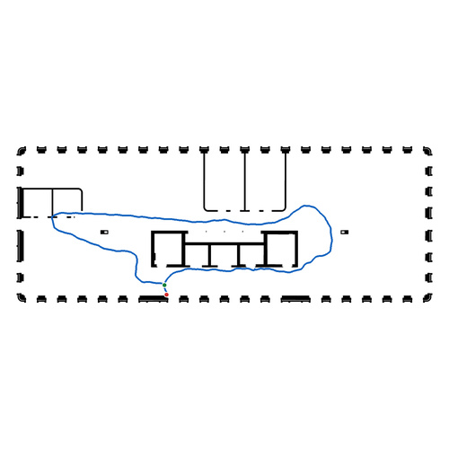</a></td>
    </tr>
    <tr>
      <td align="left"><a href="https://huggingface.co/datasets/Hilti-Research/hilti-trimble-slam-challenge-2026/tree/main/data/floor_6/2025-12-02/run_1/rosbag">floor_6_2025-12-02_run_1</a></td>
      <td align="center">-</td>
      <td align="center">-</td>
      <td align="center">-</td>
      <td align="center">✅</td>
      <td align="center">-</td>
      <td align="center"><a href="../media/groundtruth_floorplans/floor_6_2025-12-02_run_1.jpg">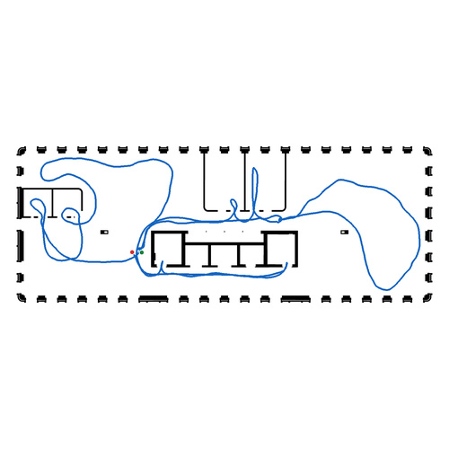</a></td>
    </tr>
    <tr>
      <td align="left"><a href="https://huggingface.co/datasets/Hilti-Research/hilti-trimble-slam-challenge-2026/tree/main/data/floor_6/2025-12-02/run_2/rosbag">floor_6_2025-12-02_run_2</a></td>
      <td align="center">-</td>
      <td align="center">-</td>
      <td align="center">-</td>
      <td align="center">-</td>
      <td align="center">-</td>
      <td align="center"><a href="../media/groundtruth_floorplans/floor_6_2025-12-02_run_2.jpg">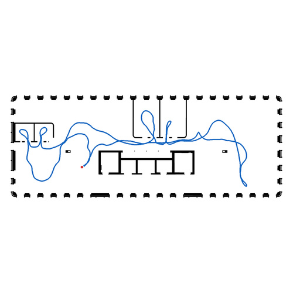</a></td>
    </tr>
    <tr>
      <td align="left"><a href="https://huggingface.co/datasets/Hilti-Research/hilti-trimble-slam-challenge-2026/tree/main/data/floor_7/2025-12-02/run_1/rosbag">floor_7_2025-12-02_run_1</a></td>
      <td align="center">-</td>
      <td align="center">-</td>
      <td align="center">-</td>
      <td align="center">-</td>
      <td align="center">-</td>
      <td align="center"><a href="../media/groundtruth_floorplans/floor_7_2025-12-02_run_1.jpg">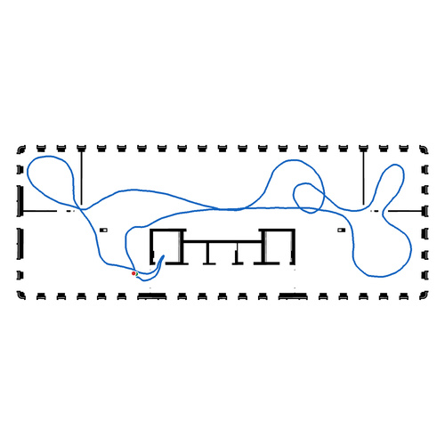</a></td>
    </tr>
    <tr>
      <td align="left"><a href="https://huggingface.co/datasets/Hilti-Research/hilti-trimble-slam-challenge-2026/tree/main/data/floor_7/2025-12-02/run_2/rosbag">floor_7_2025-12-02_run_2</a></td>
      <td align="center">-</td>
      <td align="center">✅</td>
      <td align="center">-</td>
      <td align="center">✅</td>
      <td align="center">-</td>
      <td align="center"><a href="../media/groundtruth_floorplans/floor_7_2025-12-02_run_2.jpg">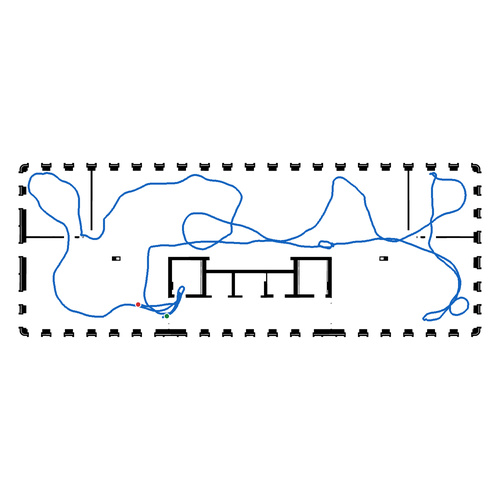</a></td>
    </tr>
    <tr>
      <td align="left"><a href="https://huggingface.co/datasets/Hilti-Research/hilti-trimble-slam-challenge-2026/tree/main/data/floor_7/2025-12-03/run_1/rosbag">floor_7_2025-12-03_run_1</a></td>
      <td align="center">-</td>
      <td align="center">-</td>
      <td align="center">-</td>
      <td align="center">-</td>
      <td align="center">-</td>
      <td align="center"><a href="../media/groundtruth_floorplans/floor_7_2025-12-03_run_1.jpg">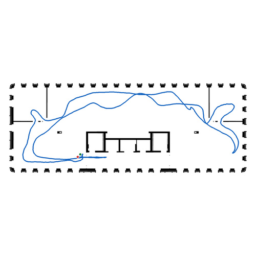</a></td>
    </tr>
    <tr>
      <td align="left"><a href="https://huggingface.co/datasets/Hilti-Research/hilti-trimble-slam-challenge-2026/tree/main/data/floor_EG/2025-10-16/run_1/rosbag">floor_EG_2025-10-16_run_1</a></td>
      <td align="center">✅</td>
      <td align="center">✅</td>
      <td align="center">-</td>
      <td align="center">-</td>
      <td align="center">-</td>
      <td align="center"><a href="../media/groundtruth_floorplans/floor_EG_2025-10-16_run_1.jpg">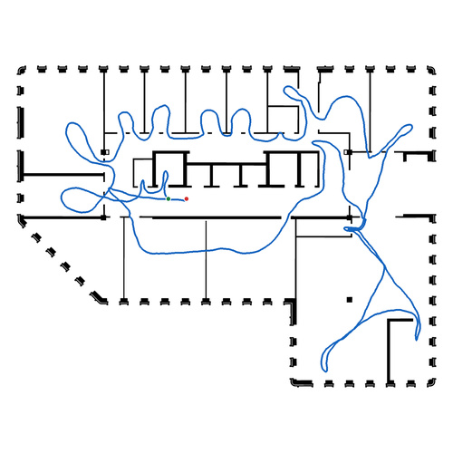</a></td>
    </tr>
    <tr>
      <td align="left"><a href="https://huggingface.co/datasets/Hilti-Research/hilti-trimble-slam-challenge-2026/tree/main/data/floor_EG/2025-12-02/run_1/rosbag">floor_EG_2025-12-02_run_1</a></td>
      <td align="center">✅</td>
      <td align="center">✅</td>
      <td align="center">-</td>
      <td align="center">-</td>
      <td align="center">-</td>
      <td align="center"><a href="../media/groundtruth_floorplans/floor_EG_2025-12-02_run_1.jpg">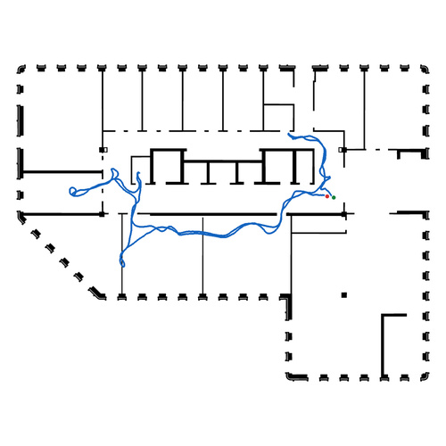</a></td>
    </tr>
    <tr>
      <td align="left"><a href="https://huggingface.co/datasets/Hilti-Research/hilti-trimble-slam-challenge-2026/tree/main/data/floor_EG/2025-12-02/run_2/rosbag">floor_EG_2025-12-02_run_2</a></td>
      <td align="center">✅</td>
      <td align="center">✅</td>
      <td align="center">-</td>
      <td align="center">✅</td>
      <td align="center">-</td>
      <td align="center"><a href="../media/groundtruth_floorplans/floor_EG_2025-12-02_run_2.jpg">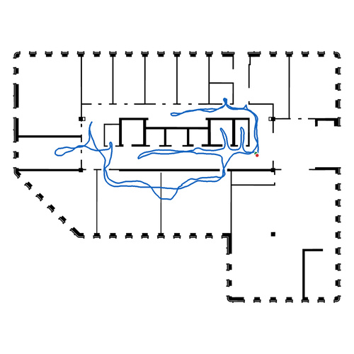</a></td>
    </tr>
    <tr>
      <td align="left"><a href="https://huggingface.co/datasets/Hilti-Research/hilti-trimble-slam-challenge-2026/tree/main/data/floor_UG1/2025-05-19/run_1/rosbag">floor_UG1_2025-05-19_run_1</a></td>
      <td align="center">✅</td>
      <td align="center">-</td>
      <td align="center">-</td>
      <td align="center">-</td>
      <td align="center">✅</td>
      <td align="center"><a href="../media/groundtruth_floorplans/floor_UG1_2025-05-19_run_1.jpg">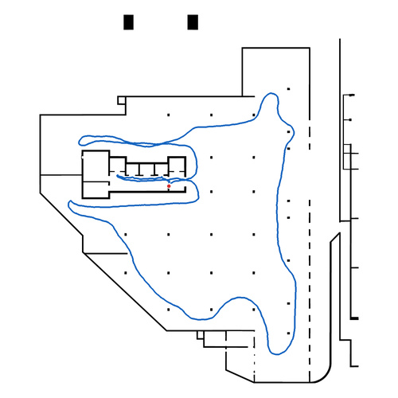</a></td>
    </tr>
    <tr>
      <td align="left"><a href="https://huggingface.co/datasets/Hilti-Research/hilti-trimble-slam-challenge-2026/tree/main/data/floor_UG1/2025-06-18/run_1/rosbag">floor_UG1_2025-06-18_run_1</a></td>
      <td align="center">-</td>
      <td align="center">-</td>
      <td align="center">-</td>
      <td align="center">-</td>
      <td align="center">✅</td>
      <td align="center"><a href="../media/groundtruth_floorplans/floor_UG1_2025-06-18_run_1.jpg">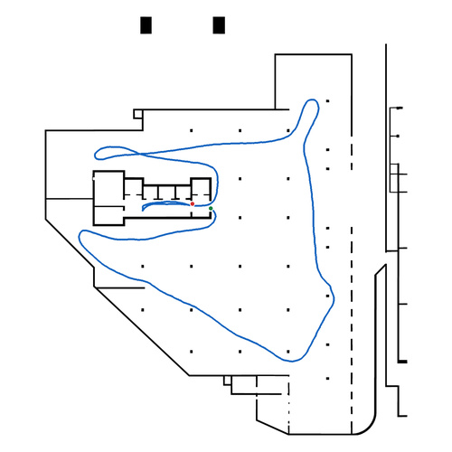</a></td>
    </tr>
    <tr>
      <td align="left"><a href="https://huggingface.co/datasets/Hilti-Research/hilti-trimble-slam-challenge-2026/tree/main/data/floor_UG1/2025-10-16/run_1/rosbag">floor_UG1_2025-10-16_run_1</a></td>
      <td align="center">✅</td>
      <td align="center">-</td>
      <td align="center">-</td>
      <td align="center">-</td>
      <td align="center">-</td>
      <td align="center"><a href="../media/groundtruth_floorplans/floor_UG1_2025-10-16_run_1.jpg">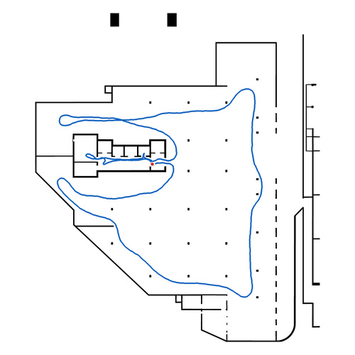</a></td>
    </tr>
    <tr>
      <td align="left"><a href="https://huggingface.co/datasets/Hilti-Research/hilti-trimble-slam-challenge-2026/tree/main/data/floor_UG1/2025-12-02/run_1/rosbag">floor_UG1_2025-12-02_run_1</a></td>
      <td align="center">-</td>
      <td align="center">✅</td>
      <td align="center">-</td>
      <td align="center">-</td>
      <td align="center">✅</td>
      <td align="center"><a href="../media/groundtruth_floorplans/floor_UG1_2025-12-02_run_1.jpg">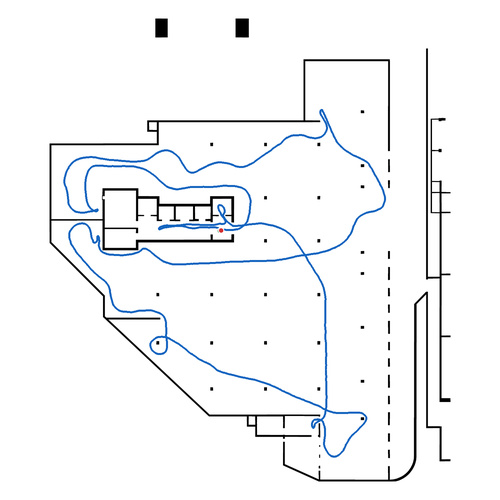</a></td>
    </tr>
    <tr>
      <td align="left"><a href="https://huggingface.co/datasets/Hilti-Research/hilti-trimble-slam-challenge-2026/tree/main/data/floor_UG1/2025-12-02/run_2/rosbag">floor_UG1_2025-12-02_run_2</a></td>
      <td align="center">-</td>
      <td align="center">✅</td>
      <td align="center">-</td>
      <td align="center">-</td>
      <td align="center">✅</td>
      <td align="center"><a href="../media/groundtruth_floorplans/floor_UG1_2025-12-02_run_2.jpg">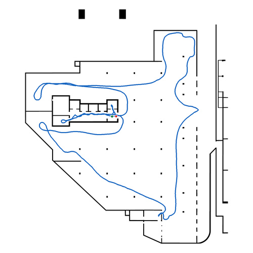</a></td>
    </tr>
    <tr>
      <td align="left"><a href="https://huggingface.co/datasets/Hilti-Research/hilti-trimble-slam-challenge-2026/tree/main/data/floor_UG1/2025-12-03/run_1/rosbag">floor_UG1_2025-12-03_run_1</a></td>
      <td align="center">-</td>
      <td align="center">-</td>
      <td align="center">-</td>
      <td align="center">-</td>
      <td align="center">-</td>
      <td align="center"><a href="../media/groundtruth_floorplans/floor_UG1_2025-12-03_run_1.jpg">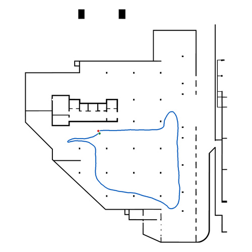</a></td>
    </tr>
    <tr>
      <td align="left"><a href="https://huggingface.co/datasets/Hilti-Research/hilti-trimble-slam-challenge-2026/tree/main/data/floor_UG2/2025-12-02/run_1/rosbag">floor_UG2_2025-12-02_run_1</a></td>
      <td align="center">-</td>
      <td align="center">✅</td>
      <td align="center">-</td>
      <td align="center">-</td>
      <td align="center">✅</td>
      <td align="center">Unavailable (no floorplan)</td>
    </tr>
  </tbody>
</table>

> [!NOTE]
> Please, if you have any doubt or issue refer to the **[Issues section](https://github.com/Hilti-Research/hilti-trimble-slam-challenge-2026/issues)**.

---

Next: [install the ROS tools](challenge-tools.md#install-challenge-tools), read about [floorplans](floorplans.md), or check [which runs are evaluated](challenge-evaluation.md#final-score).
