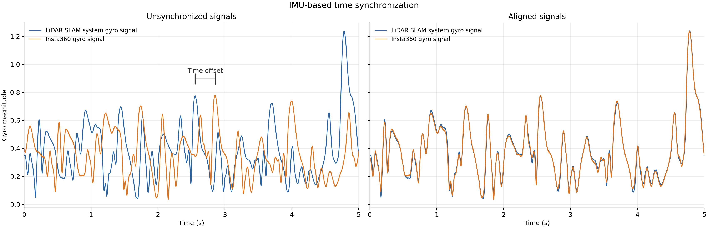

[Home](../README.md) · [Documentation guide](../README.md#documentation)

# Ground Truth

Ground truth is provided in `cam0->map` convention (the transformation that expresses the pose of `cam0` in the `map` frame). You can find the ground truth files for all the sequences [here](https://huggingface.co/datasets/Hilti-Research/hilti-trimble-slam-challenge-2026/tree/main/groundtruth).

They were acquired using a [LiDAR](sensors.md#lidar-ground-truth-acquisition) system, and transformed using LiDAR-camera extrinsics and IMU time alignment. Since the LiDAR starts slightly later than the camera, we will not evaluate the trajectory during the first 5 seconds of each run.

## Initial Localization in Floorplan

To provide an initial localization estimate (for the localization task) we provide the ground-truth camera pose at approximately t = 10005 sec in [init_gt_poses.csv](../groundtruth/init_gt_poses.csv) (the start camera timestamp is t = 10000 sec).

## Sensor Synchronization

The ground-truth LiDAR and IMU are hardware-synchronized using a PPS signal. To synchronize the independently running Insta360 system, we align the two IMU streams using the norm of the gyroscope measurements, which is invariant to the relative IMU orientation. A brute-force correlation search first provides an initial time offset, followed by nonlinear refinement of the time offset and linear clock-scale factor by minimizing the difference between the two IMU signals, using cubic interpolation for continuous-time sampling. Gyroscope biases are optimized jointly. A visualization of synchronized IMU signals is provided in the figure below:

  

---

Related: [floorplan conventions](floorplans.md#coordinate-frame-and-initial-pose) · [evaluation rules](challenge-evaluation.md) · [OpenVINS visualization](openvins.md#run-openvins).
